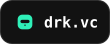
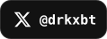
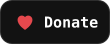

<div align="center">



<a href="https://drk.vc"></a>&nbsp;
<a href="https://x.com/drkxbt"></a>&nbsp;
<a href="https://t.me/drk9999"></a>&nbsp;
<a href="https://drk.vc/donate"></a>

</div>

<br>



## Source

Everything I ship is open source. New repos land here first, with a full write-up on [drk.vc/source](https://drk.vc/source).

> The first repo is on its way.

## Gallery



## Donate

If my code saved you time, tips are welcome on any of these. Thank you.

<table>
  <tr>
    <td align="center"><br><b>Solana</b></td>
    <td align="center"><br><b>EVM</b></td>
    <td align="center"><br><b>Bitcoin</b></td>
  </tr>
</table>

**Solana**

```text
2LS2xxrF3VZyVPFn3uZj1PpZHZ6uXxRmMDKxn12iXUaV
```

**EVM**

```text
0xfc4F786d1feAaf771e0e3Fd0BD29d8AdD2e1fD1E
```

**Bitcoin**

```text
bc1q733m6lh5mayfjts6l4eqgu2glyxwzqjxpc4qva
```

<p align="center"><sub><a href="https://drk.vc">drk.vc</a> · no trackers, no cookies</sub></p>
